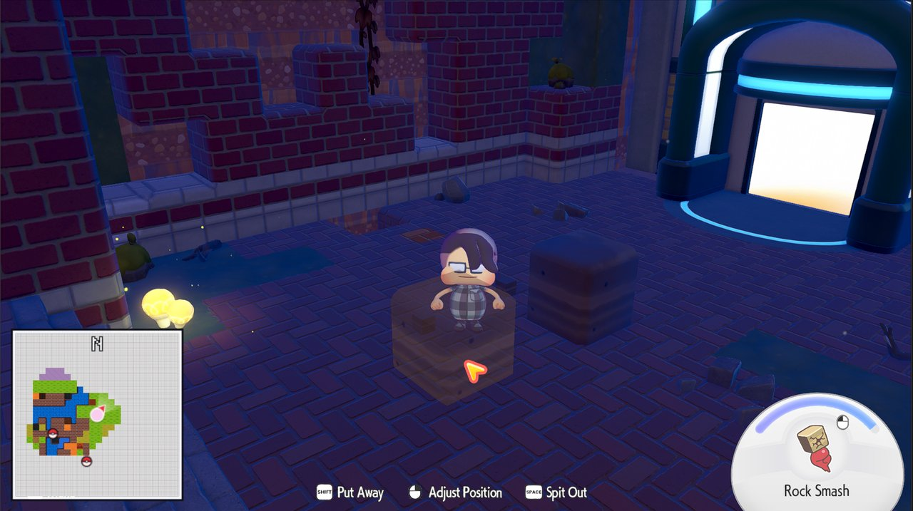
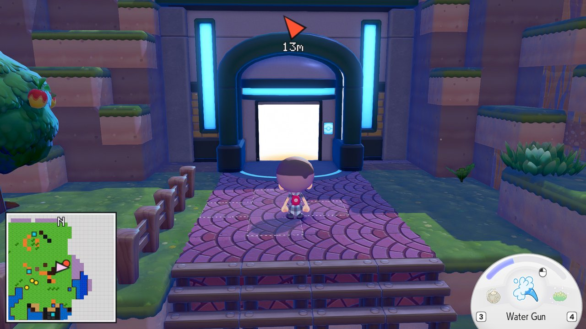
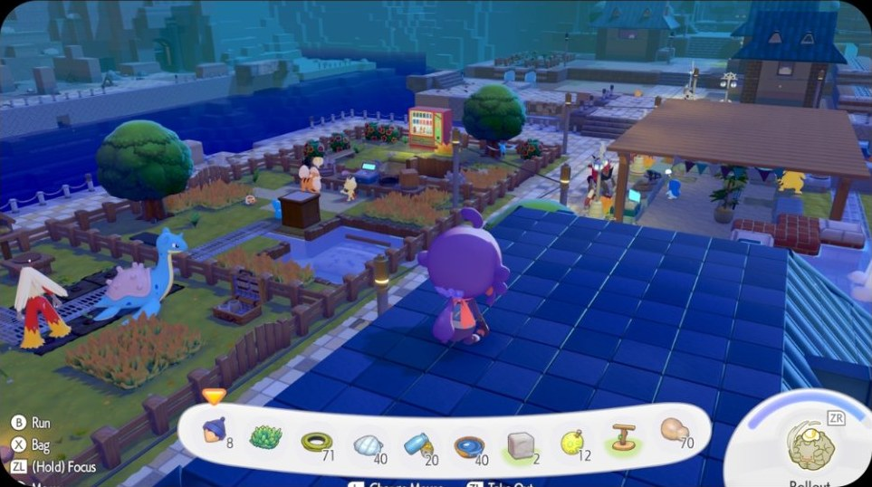
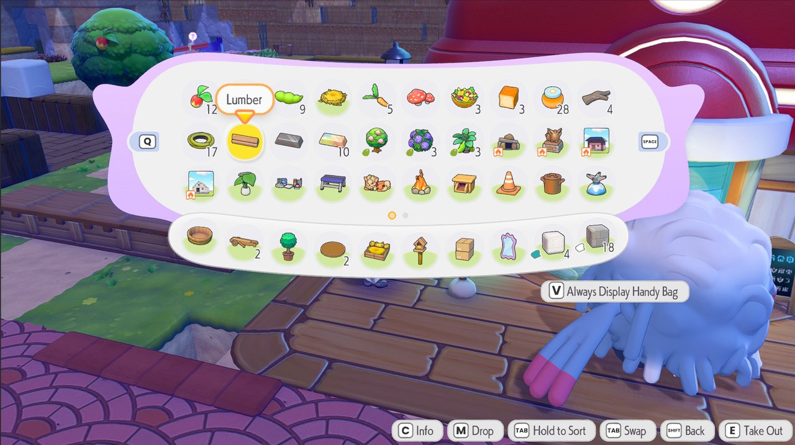
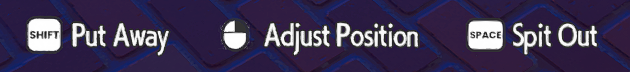
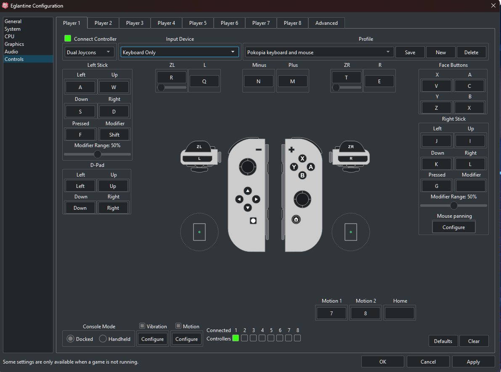

<!--
# SPDX-FileCopyrightText: Copyright 2025 Eden Emulator Project
# SPDX-License-Identifier: GPL-3.0-or-later

# SPDX-FileCopyrightText: 2018 yuzu Emulator Project
# SPDX-License-Identifier: GPL-2.0-or-later
-->
<!-- lang: en-GB -->

<h1 align="center">
   
  
   
  <b>Pikantine</b>
   
</h1>

<h4 align="center">A Pokémon Pokopia build of Eglantine, the experimental, free and open-source Nintendo Switch 2 emulator written in C++, derived from Eden, yuzu and Sudachi.</h4>

> [!NOTE]
> **Pikantine** is SpiderNic96's `Pikantine` branch of [notsapinho/Eglantine](https://github.com/notsapinho/Eglantine), with Pokémon Pokopia (2.0.1) extras: keyboard and mouse play, a live minimap with pings, and more Pokémon living in your world.
> Builds: [GitHub Releases](https://github.com/SpiderNic96/Pikantine/releases), tagged `pokecap-build-<n>`. All configured platforms build automatically on pushes to `main`; individual platforms can also be rebuilt with the Actions workflow dispatcher.

## What Pikantine adds over notsapinho's Eglantine

Everything here is for **Pokémon Pokopia 2.0.1** (build ID `76A489F3…`), only works with the **Dynarmic CPU backend** (not NCE), and can be switched off on its own (see [Switches](#switches)). The base is notsapinho's `main` at `780a1d08`.

| Area | notsapinho/Eglantine | Pikantine |
| --- | --- | --- |
| Joy-Con 2 mouse | Switch 2 mouse (Nmouse) works | Joy-Con 2 mouse fixes; it works alongside mouse panning (middle click swaps); the wheel taps the D-pad |
| Camera | Right stick only | Mouse turns the camera through a game hook; the camera updates every frame above 120 fps |
| Menus | Controller only | Click menu entries with the mouse (the cursor steers to them); right click is B |
| Keyboard and mouse | Generic | A ready-made **Pokopia keyboard and mouse** input profile; a tool that turns the button prompts into keyboard and mouse glyphs (texture mod) |
| Texture mods | — | Texture dumping and replacement (`EDEN_TEXTURE_DUMP`, `tools/texture_mods`) |
| Minimap | — | The game's own map, **live on screen while you play**: you, Pokémon walking around, buildings and exits, north up |
| Settings | — | A **Pikantine** page in Settings: minimap on or off, the Pokémon limit, the save editor |
| Waypoints | — | A **ping** with an arrow and its distance at the top of the screen; set it with **G**, a click on the pause menu's map, **L3+R3**, or the **right stick and R3 on the pause map** |
| Pokémon limit | The game's own (25 living, 30 in all) | **Up to 50** (default 30); raised a couple at a time once you are in play, so loading stays fast |
| Builds | Every platform, on pushes to `main` | Every configured platform, on pushes to `main`; channel `pokecap-build-<n>` |

### Live minimap and ping

The game's own pause-menu map, redrawn live into the bottom-left corner: the pink arrow is you, Poké Balls are Pokémon, symbols mark the PC, the Pokémon Center, houses and exits.

With a ping set, an arrow at the top points to it with the distance; the pin shows on the minimap. Press **G** again where the ping is (or **L3+R3**) to lift it.

Hide or show the minimap at any time with **F7** or **Home + D-pad Left** (the *Toggle Pokopia Minimap* hotkey, changeable under Settings → General → Hotkeys), or with the checkbox in Settings → Pikantine.

### Controller cursor on the pause map

On the pause menu's map the **right stick** moves a crosshair and **R3** drops the ping under it (or lifts it when the crosshair is on it); an "R3 PING" hint shows under the map. With a mouse, click the map instead.

*Screenshot to come: new in pokecap-build-31.*

### More Pokémon

The limit of Pokémon living in your world is a game setting; this build raises it (Settings → Pikantine, 0–50, default 30; 0 keeps the game's own; changes apply while the game runs). Testers saw Pokémon settle in areas they never reached before, because the old limit filled up near the start.

How it works:
- The limit is per area: the game places an area's Pokémon while it loads (each area starts from an empty pool of 64), so higher numbers make entering an area slower; around 30 stays quick.
- The limit is never lowered while you play (lowering it had the game send Pokémon away until a restart).
- The game also keeps only 30 Pokémon *active* (drawn and moving) at once, nearest first; above 30 it sent the farthest out, and the ones out when you left an area stayed invisible on your next visit (Honey then found them "already here"). This build raises that number with the limit, so every placed Pokémon stays active. The log shows it: `Pokopia Pokémon limit: N active at once`.
- The log shows how full the pool is: `Pokopia Pokémon slots: N of 64 in use`.
- The game's pool holds 64 Pokémon, visitors included, so 50 is the most this allows.

> [!WARNING]
> Back up your save before raising the limit. Going back to a build without it may have the game send the extra Pokémon away.

### Save editor

Settings → Pikantine → **Open the save editor**, with the game stopped. It opens the current user profile's Pokopia save. If that profile has none, it asks whose save to edit. **Browse** still opens any save folder (the one holding `G00`).

- **Pokédex tab:** all 374 entries by name, with each habitat it appears in, the areas that habitat works in for it, and whether it's rare there. Pick an area to list only what can appear on that island. Click a box to cycle it: empty (not yet), half (seen), ticked (registered).
- **Habitats tab:** every habitat by name, with the Pokémon it draws and where: empty, half (discovered), ticked (built). The same area filter works here.
- **Recipes tab:** all 921 recipes by the item they make; tick to learn. Recipes you already know stay as they are (the editor only adds).
- **Moves tab:** learn moves (they go on the move wheel if there's room) and their upgrades: Dive, liquid absorption and the food boosts. Ticking an upgrade also ticks the move it needs.
- **Reactions tab:** learn reactions; new ones fill empty slots on the reaction wheel.
- **Bag tab:** set any of the 120 bag slots or the 10 bar slots to any item and count, or put an item in the first empty slot.
- **Residents tab:** change a resident's friendship and whether its naming chat is done. **Add resident** (experimental, untested in game) writes a new resident with no home yet into the area you pick.
- **Flags tab:** the game's 250 numbered feature flags. The game ships without their names, so only a few are known. The notes say what the game does with each one. You can label a flag yourself, and the label is kept between saves. Story flags can break your progress, so change one at a time.
- **Unlock everything** registers every Pokémon, builds every habitat and learns every recipe. Registered Pokémon are also marked as seen in each of their habitats, which fills the "?" on habitat pages. Registering a Pokémon also marks its habitats discovered, unless you untick that option.
- Dex rewards (the recipes at 6, 15, 20… registered) are left unclaimed, so the game hands them out itself.
- The save folder is copied to `pikantine_backups` in Eglantine's folder before anything is written. Only Pokopia 2.0.1 saves are edited.
- Names come from the game's own tables (see [docs/pokecap/save-layout.md](docs/pokecap/save-layout.md)). The moves, reactions, bag, residents and flags layouts, and their names, are [PokoHex](https://github.com/berichan/PokoHex)'s (berichan, GPL-3.0). Where each Pokémon appears (habitat, areas, rarity) comes from the public databases dittobase.com and cliffchang11/Pokopia_Cliff; 22 special Pokémon (legendaries, Ditto, Kyogre, Volcanion, Phione, Manaphy and the 2.0 additions) have none listed.

### Mouse in menus and in play

Menus take mouse clicks: the game's cursor is steered to the entry you click, then A is pressed. Right click is B, the wheel is D-pad up and down. In play the mouse turns the camera; the left button is ZR and the right ZL.

### Keyboard and mouse glyphs and profile

The game's button prompts show keys and mouse buttons (made with [`tools/texture_mods`](tools/texture_mods), from Recompia's Kenney Input Prompts, CC0).

The profile lives in [`mods/Pokemon Pokopia (0400A3A01EE4C000)/Keyboard and mouse`](<mods/Pokemon Pokopia (0400A3A01EE4C000)/Keyboard and mouse>), whose README lists every key.

### Switching between keyboard and mouse and a DualSense

Settings → Pikantine → **Controls and button icons** → **Play Pokopia with** (change it with the game stopped):

- **Keyboard and mouse:** Player 1 uses the **Pokopia keyboard and mouse** profile. It's keyboard only, as Dual Joycons, so the Joy-Con mouse mode still works.
- **DualSense (as a Pro Controller):** Player 1 uses the **Pokopia DualSense** profile. It's made from your pad the first time you pick it, so connect the pad before pressing OK. Tick **Cross confirms and Circle goes back** to swap A and B.

The chosen profile is loaded into Player 1 every time Pokopia starts, so switching back and forth always lands on the right controls. Binds you change under Emulation → Configure → Controls are saved into that profile when you press OK, so custom binds stay.

**Button icons** is "Drawn from Player 1's controls" by default. When the game starts, each prompt is drawn from what that button is bound to: a key, a mouse button, or the DualSense button it's on, including Options (three bars) and Create (three rays). So a swap or a custom bind shows the right icon, and the title's "PRESS (A) BUTTON" follows A. Buttons on other pads keep the Switch icons.

Set it to "The game's own, or an icon mod" to use the icon mods instead. The build makes both the first time Pokopia starts, from your own copy of the game, in the game's mod folder: `Keyboard and mouse glyphs` and `PlayStation glyphs` (the DualSense's default binds). Eglantine loads the one matching your choice. [`tools/texture_mods/pokopia_kbm_glyphs.py`](tools/texture_mods/pokopia_kbm_glyphs.py) still makes the same mods from a texture dump (`--style ps` for PlayStation).

### Switches

Most people only need Settings → **Pikantine**. These are for testing; set them before starting Eglantine (Windows Command Prompt: `set NAME=value`, then `eglantine.exe`).

| Variable | Does |
| --- | --- |
| `EDEN_POKOPIA_POKEMON_CAP` | Pokémon limit, overriding Settings → Pikantine: 1–50, or `0` for the game's own |
| `EDEN_POKOPIA_POKEMON_STAGED=0` | Raise the limit at once instead of in play (slow loading) |
| `EDEN_POKOPIA_NAV=0` | No minimap or ping |
| `EDEN_POKOPIA_MAP_REFRESH_MS` | How often the minimap is redrawn (default 2000) |
| `EDEN_POKOPIA_MOUSE_CAMERA=0` | No mouse camera (and no minimap, which needs it) |
| `EDEN_POKOPIA_CAMERA_EVERY_FRAME=0` | Camera at the game's own 120 Hz |
| `EDEN_POKOPIA_MENU_MOUSE=0` | No mouse clicks in menus |
| `EDEN_POKOPIA_MENU_LOG=1` | Log the menus' layouts (for bug reports) |

### Known issues

- Some menus pick the first entry instead of the clicked one (Daily Challenges, the Stamp Card, the Handy Bag's bottom row), and a few bounce between entries.
- With the mouse there is no way yet to raise, lower or turn an object you are placing; the photo camera pans only with the arrow keys.
- The Pokémon Center and house symbols on the minimap may be swapped.
- The controller cursor on the pause map and the staged Pokémon limit are still being tested.

## What notsapinho's Eglantine adds over its base

Eglantine continues [Djihads80/Eglantine](https://github.com/Djihads80/Eglantine) on top of [Eden](https://git.eden-emu.dev/eden-emu/eden) (Eden's history up to June 2026, then about 1,700 commits of its own). In broad strokes:

- **Switch 2 games**: the Switch 2 program format (NPDM ACID layout, loose ExeFS), ARMv8.1–8.5 instructions in Dynarmic, and the Switch 2 system services (`nx2:*`, such as display and GPU).
- **Switch 2 GPU**: Switch 2 memory mapping, native GPU state, shader recompiler support for Switch 2 shaders, compute and tensor programs (Donkey Kong Bananza), its own shader cache.
- **Game files**: `.nup` dumps and updates (platform detection, verified extraction, an editor), shown in the game list.
- **Games**: Pokémon Pokopia playable; Mario Kart World, Splatoon Raiders, Donkey Kong Bananza and Hyrule Warriors brought up, with per-game fixes.
- **Extras**: FSR 3 frame generation, a Joy-Con 2 mouse (Nmouse), private-server gateway routing with its own certificate, ready-made mods (Pokopia frame-rate mods).
- **Builds**: clang with profile-guided optimization trained on Pokopia, `eden-cli` in every package, an update checker and news feed reading notsapinho's releases.

See [notsapinho/Eglantine](https://github.com/notsapinho/Eglantine) for its own history and notes.

---

  
  
  

  <a href="#compatibility">Compatibility</a> |
  <a href="#download">Download</a> |
  <a href="#getting-started">Getting started</a> |
  <a href="#mods">Mods</a> |
  <a href="#building">Building</a> |
  <a href="#contributing">Contributing</a> |
  <a href="#license">License</a>

> [!WARNING]
> Eglantine is very experimental. Expect crashes, graphical glitches and missing features, and keep backups of your saves.

## Compatibility

| Game | Status |
| --- | --- |
| Pokémon Pokopia | Playable. |
| Mario Kart World | Runs at decent to full speed, depending on your hardware and settings. |
| Splatoon Raiders | Runs, with variable performance. |

Other games are being brought up. A full compatibility list will follow.

## Download

Every change to `main` is built and published on the [Releases](https://github.com/notsapinho/Eglantine/releases) page. Day-to-day work happens on `dev`, which has no automatic builds. Every package is built with clang and profile-guided optimization (PGO). The x86_64 packages need a CPU with AVX2 (x86-64-v3: Intel Haswell from 2013, AMD Ryzen, or newer); on an older one the emulator says so and quits.

| System | File | Notes |
| --- | --- | --- |
| Windows x64 | `eglantine-windows-x86_64.zip` | Extract and run `eglantine.exe`. |
| Linux x86_64 / arm64 | `eglantine-linux-*.AppImage` | Self-contained; needs glibc 2.39 or newer (Ubuntu 24.04, Fedora 40, Debian 13, Arch). `chmod +x` it, then run it. |
| Linux x86_64 / arm64 | `eglantine-linux-*.tar.gz` | Uses your system's Qt 6 and libraries. |

`eden-cli` (the command-line frontend) ships next to `eglantine` in every package.

## Getting started

You need:

- A GPU with Vulkan 1.3 support and up-to-date drivers.
- Your own console's keys and firmware, dumped from your own hardware. Eglantine does not include them, and they can't be shared.
- Games you own, dumped from your own cartridges or eShop purchases.

The [User Handbook](./docs/user/README.md) covers setup, with a [Quick Start](./docs/user/QuickStart.md), controllers, mods, saves and troubleshooting.

## Mods

The [`mods`](./mods) folder has ready-made mods for some games. Its README lists them and shows how to install one.

## Building

See the [General Build Guide](./docs/Build.md). On Windows, [`tools/windows/build.ps1`](./tools/windows/build.ps1) builds with MSVC and needs no administrator rights. The other development tools are described in the [tools directory](./tools).

## Contributing

Pull requests are welcome; open them against `dev`. Please keep changes focused and documented, and describe how you tested them. For development discussions, join the [Discord](https://discord.gg/XkS5NVPTUY).

## Credits

Eglantine was started by Camille LaVey ([Djihads80/Eglantine](https://github.com/Djihads80/Eglantine)) and builds on the work of the [Eden](https://git.eden-emu.dev/eden-emu/eden), yuzu and Sudachi projects and their contributors.

Eglantine is not affiliated with or endorsed by Nintendo. Use it only with games, keys and firmware you own and dumped yourself.

## License

Eglantine is licensed under the GPLv3 (or any later version). See [LICENSE.txt](./LICENSE.txt).
